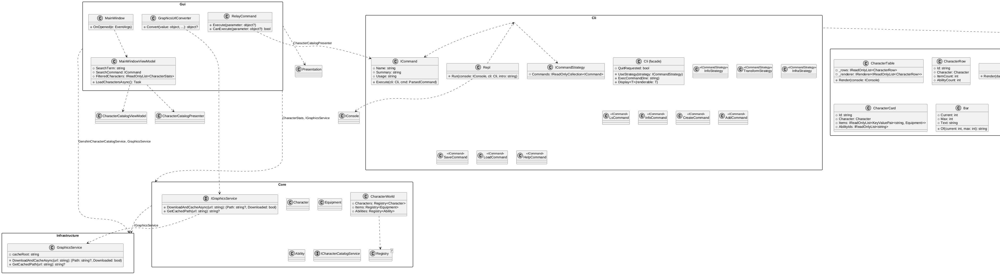
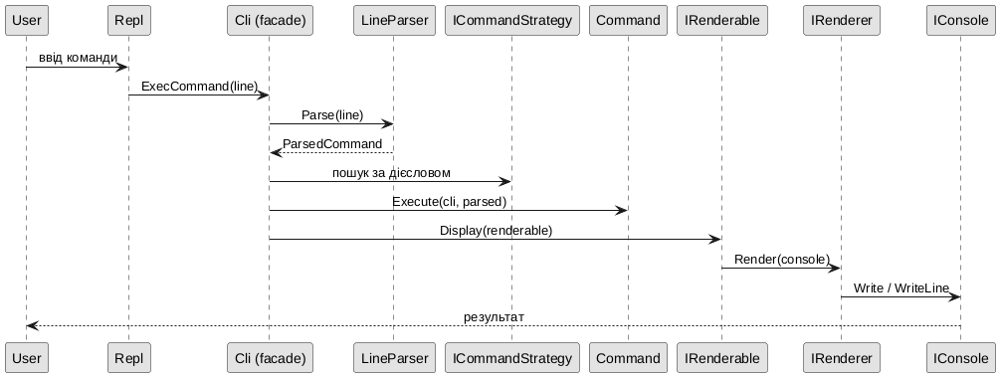

# Дизайн-документ: CLI каталогу персонажів

Проєкт `CliInterface-ProjectOOP`, автор: Марк Воскобойников, КН-31.
Тема технічного завдання «Командний інтерфейс додатка» - консольний інтерфейс до каталогу
персонажів. Документ описує архітектуру, протокол взаємодії з користувачем
і рішення, прийняті під час реалізації.

## 1. Мета і рамки

Потрібно, користуючись схемою з методички, спроектувати і реалізувати
клієнтський CLI для довільного типу даних. Обрано **каталог персонажів**:
список персонажів із загальною інформацією та посиланням на зображення,
створення через діалог, збереження даних.

Ключові обмеження схеми:

* інтерфейс побудований поверх **фасада**, який надає три методи -
  `useStrategy`, `execCommand`, `display`;
* кожна команда - це клас, реалізований через **патерн «Стратегія»**;
  стратегії групують команди за категоріями (інформаційні,
  трансформативні, інфраструктурні);
* будь-який вивід даних відокремлено від логіки через патерн
  **«Рендерер»** (`IRenderer` + `IRenderable`), обрано варіант 2 діаграми -
  `IRenderable` сам агрегує свій `IRenderer`.


## 2. Шари і залежності

```
App -> { Cli -> { Core, Data }, Data -> Core }
Infrastructure -> Core
Presentation -> Core + Infrastructure
Api -> Core
Gui -> Core + Infrastructure + Presentation
```

| Шар | Відповідальність | Що заборонено |
|---|---|---|
| `Core` | домен: `CharacterStats`, `DamageCalculator`, `ICharacterCatalogService` | не знає про консоль, файли і мережу |
| `Data` | порт `IWorldStore` + JSON-реалізація `JsonWorldStore` | не знає про консоль |
| `Cli` | фасад, парсер, REPL, рендери, стратегії | не знає про формат файлу даних |
| `App` | точка входу: розбір аргументів, збірка залежностей | не містить логіки |
| `Infrastructure` | `GenshinCharacterCatalogService` - віддалений JSON API з локальним fallback на `data/characters.json` | не містить бізнес-логіки |
| `Presentation` | `CharacterCatalogPresenter` + `CharacterCatalogViewModel` - GUI-agnostic подання каталогу | не знає про конкретний GUI-фреймворк |
| `Api` | локальна демо-API над `data/characters.json` (Minimal API, `:5000`) | не містить бізнес-логіки, тільки серіалізація |
| `Gui` | Avalonia UI - кроссплатформенний графічний інтерфейс каталогу (вікно списку персонажів із пошуком і картками) | не містить бізнес-логіки, використовує Presentation |

`GenshinCharacterCatalogService` намагається завантажити персонажів з віддаленого API.
На момент розробки публічні Genshin API не відповідали, тому сервіс
при недоступності мережі автоматично використовує локальний fallback-файл. Бізнес-шар ніколи не залежить від
доступності мережі.

Доменний шар скопійований з попереднього проєкту `Shell-ProjectOOP` і доопрацьований: у `Character` додано поле
`GraphicsUrl` (посилання на зображення - вимога теми), реєстри отримали
виняток `CatalogException` і підтримку завантаження стану.

## 3. Фасад `Cli`

```csharp
public sealed class Cli
{
    public void UseStrategy(ICommandStrategy strategy);
    public void ExecCommand(string line);
    public void Display<T>(T renderable) where T : IRenderable;
    public bool QuitRequested { get; }
}
```

* `UseStrategy` реєструє стратегію і додає її команди до словника
  дієслів; повторна реєстрація команди - помилка конфігурації;
* `ExecCommand` розбирає рядок, знаходить команду за дієсловом і
  виконує її; він **ніколи не генерує винятків** - всі помилки (синтаксис,
  невідомі команди, доменні порушення) перетворюються на рядок
  `Error: ...`; `exit` не виконується як команда, а ставить прапорець
  `QuitRequested`, який читає REPL;
* `Display` - єдина точка виводу даних: об'єкт подання сам знає свій
  рендерер і той малює на консолі фасада.

## 4. Стратегії команд

`ICommandStrategy` повертає набір `ICommand` (дієслово, коротка довідка,
детальний usage, `Execute(Cli cli, ParsedCommand command)`).

| Стратегія | Категорія | Команди |
|---|---|---|
| `InfoStrategy` | інформаційні | `ls`, `info`, `search` |
| `TransformStrategy` | трансформативні | `create`, `add` (кожна мутація автоматично зберігається) |
| `InfraStrategy` | інфраструктурні | `save`, `load`, `help` |

Розділення за категоріями задає політику доступу до даних:
інформаційні читають, трансформативні пишуть (і тому мають `IWorldStore`),
інфраструктурні керують даними і довідкою.

## 5. Рендери

Обрано **варіант 2** діаграми: об'єкт, що відображається,
агрегує свій рендерер.

```
IRenderer<T>  --- renders T -->  IConsole
IRenderable { void Render(IConsole console) }
CharacterCardView : IRenderable { CharacterCard + CharacterCardRenderer }
```

* `IRenderer<T>` - інтерфейс рендерера: `Render(T data, IConsole console)`;
* `IRenderable` - інтерфейс подання: `Render(IConsole)` викликає рендерер;
* `CharacterTableRenderer` малює `IReadOnlyList<CharacterRow>` - вирівняну
  таблицю з HP-баром (`Bar`);
* `CharacterCardRenderer` малює `CharacterCard` - детальну картку з
  посиланням на зображення.

Команди не форматують текст самі: вони збирають дані (рядки таблиці,
картку) і викликають `cli.Display(...)` або передають рендерер напряму.

## 6. Протокол взаємодії

* запрошення `> `, команди вводяться рядками, порожній рядок
  ігнорується, `exit` завершує цикл;
* лапки групують слова з пробілами: `info "Тестові Врата"`;
* аргументи - позиційні, опції - `--ключ значення` або прапорці;
* невідома команда: `Unknown command '<дієслово>'. Type 'help'.`;
* помилки аргументів містять usage: `Error: Wrong number of arguments
  (got 2). Usage: info <id|name>`;

Діалог створення (`create char`) покроково запитує: ім'я, максимальне
здоров'я, базову броню, базову атаку, посилання на зображення (порожньо -
без посилання), ідентифікатор (порожньо - авто `char-N`). Будь-який
крок можна скасувати словом `cancel`. Значення перевіряються
покроково: з діапазоном у підказці, повторне запитання при помилці.

## 7. Збереження даних

* `JsonWorldStore` зберігає світ у JSON: персонажі (з посиланням на
  зображення та id предметів), предмети, здібності, книги здібностей;
* запис атомарний: спочатку у `файл.tmp`, потім перейменування;
* після кожної успішної мутації (`create`, `add`) трансформативна
  стратегія зберігає світ автоматично; збій збереження повідомляється,
  але зміна лишається в пам'яті;
* під час запуску файл даних завантажується, якщо існує (`--data <шлях>`,
  стандартно `data/world.json`); `load` перечитує файл, `save` зберігає
  примусово;
* також при старті `App` завантажує персонажі з каталогової API
  (`http://localhost:5000/characters`) через
  `GenshinCharacterCatalogService` і додає їх до `world.Characters`
  разом із локальними; при недоступності API використовується fallback
  `data/characters.json` з попередженням, програма не падає.

## 7.5. Завантаження графіки та кеш

* `IGraphicsService` (Core) - інтерфейс для роботи з графікою персонажів: `DownloadAndCacheAsync(url, cancellationToken)` повертає `(string? Path, bool Downloaded)`, `GetCachedPath(url)` повертає локальний шлях або null;
* Реалізація в `Infrastructure` - `GraphicsService`, `HttpClient` з таймаутом, завантаження зображення за URL, збереження у локальну директорію даних (`Environment.SpecialFolder.LocalApplicationData`: AppData/Local на Windows, `~/.local/share` на Linux), ім'я файлу - SHA-256 хеш URL;
* Кеш: перед кожним завантаженням перевіряється наявність локального файлу за хешем URL. Якщо файл уже існує - використовується він, HTTP-запит не виконується;
* Це зменшує кількість запитів до сервера і дозволяє програмі працювати офлайн для раніше завантажених персонажів.

## 7.6. Графічний інтерфейс (Avalonia UI)

* `Gui` - Avalonia UI (`src/Gui/`) на `net10.0`, кросплатформний графічний інтерфейс каталогу персонажів (Linux і Windows). Використовує існуючі шари без змін: залежить від `Core` (`CharacterStats`, `IGraphicsService`), `Infrastructure` (`GenshinCharacterCatalogService`, `GraphicsService`) і `Presentation` (`CharacterCatalogPresenter`, `CharacterCatalogViewModel`);

### Елементи інтерфейсу

Головне вікно (`MainWindow.axaml`) містить:

* Поле введення для пошуку за іменем персонажа (`TextBox` із привязкою до `SearchTerm`);
* Кнопку «Пошук» прихована (`IsVisible="False"`), тому фільтрація відбувається автоматично при кожному введеному символі у текстовому полі.
* Статусний рядок із кількістю знайдених персонажів (`MatchCount`);
* Список карток персонажів (`ItemsControl` із `FilteredCharacters`), де кожна картка містить:
  * зображення персонажа (`Image` через `GraphicsUrlConverter`),
  * ім'я персонажа,
  * коротку інформацію (елемент, HP, DMG, ARM, RES).

### Архітектура GUI

* `MainWindowViewModel` - модель подання, реалізує `INotifyPropertyChanged`; містить колекцію `Characters`, поточний `SearchTerm`, відфільтрований список `FilteredCharacters`, команду `SearchCommand` та метод `LoadCharactersAsync()` для завантаження даних через `CharacterCatalogPresenter`;
* `RelayCommand` - проста реалізація `ICommand` для делегування виконання дії кнопки «Search»;
* `GraphicsUrlConverter` - конвертер `IValueConverter`, що перетворює URL графіки на закешований `Bitmap` через `IGraphicsService.GetCachedPath()`;
* `App.axaml.cs` - точка входу Avalonia; збирає залежності (`GenshinCharacterCatalogService`, `GraphicsService`, `CharacterCatalogPresenter`, `MainWindowViewModel`) та реєструє конвертер у ресурсах XAML.

### Особливості реалізації

* Графіка завантажується і кешується через `IGraphicsService` (SHA-256 хеш URL, локальна директорія даних, буфер) - повторне відкриття вікна не робить нових HTTP-запитів;
* Фільтрація проходить у реальному часі при кожному введенному символі у пошуковий рядок (UpdateSourceTrigger=PropertyChanged), а не лише після натискання кнопки «Search»;
* При порожньому пошуку відображаються всі завантажені персонажі;
* Структура файлів: `MainWindow.axaml` / `MainWindow.axaml.cs`, `ViewModels/MainWindowViewModel.cs`, `Commands/RelayCommand.cs`, `Converters/GraphicsUrlConverter.cs`, `App.axaml` / `App.axaml.cs`, `Gui.csproj`.

## 8. Діаграми

### 8.1 Діаграма класів (варіант 2: IRenderable агрегує IRenderer)



### 8.2 Потік виконання



## 9. Розгортання

Розгортання виконується через `dotnet publish` (компільований файл `Gui`/`Gui.exe` + необхідні `dll` бібліотеки). Потрібен `.NET 10 Runtime` на цільовій машині.

Підтримувані цільові платформи: `linux-x64`, `win-x64`.

```bash
# 1. Запустіть демо-API (в окремому вікні)
dotnet run --project src/Api/Api.csproj --urls "http://0.0.0.0:5000"

# 2. Опублікуйте GUI для Linux
dotnet publish src/Gui/Gui.csproj -c Release -r linux-x64 --self-contained false -o publish/linux-x64

# 3. Опублікуйте GUI для Windows
dotnet publish src/Gui/Gui.csproj -c Release -r win-x64 --self-contained false -o publish/win-x64
```

Запуск опублікованого додатка:

```bash
# Linux
./publish/linux-x64/Gui

# Windows
./publish/win-x64/Gui.exe
```

Альтернативно - релізний архів `katalog-gui-linux-x64.tar.gz` вже містить скомпільований додаток (GUI, API і файл даних), вихідний код не потрібен:

```bash
tar -xzf katalog-gui-linux-x64.tar.gz

# 1. Запустіть демо-API (в окремому вікні)
./Api

# 2. Запустіть GUI
./Gui
```

На Windows запустіть `Api.exe`, а потім `Gui.exe`.

API обслуговує `http://localhost:5000/characters`, GUI звертається до нього при старті. Якщо API недоступна, GUI використовує локальний файл `characters.json` з архіву.

## 10. Перевірка

* юніт-тести по шарах: `Tests.Core` (домен, реєстри), `Tests.Data`
  (збереження та відновлення даних у JSON, помилки файлу), `Tests.Cli` (фасад, стратегії,
  рендери, REPL через тестовий двійник консолі), `Tests.Infrastructure` (каталоговий
  сервіс, графічний кеш, presenter);
* вимоги збірки: без попереджень, `TreatWarningsAsErrors`,
  XML-документація для всіх загальнодоступних типів і методів;
* демосценарій `demo/demo.txt` використовується і в CI, і вручну.
